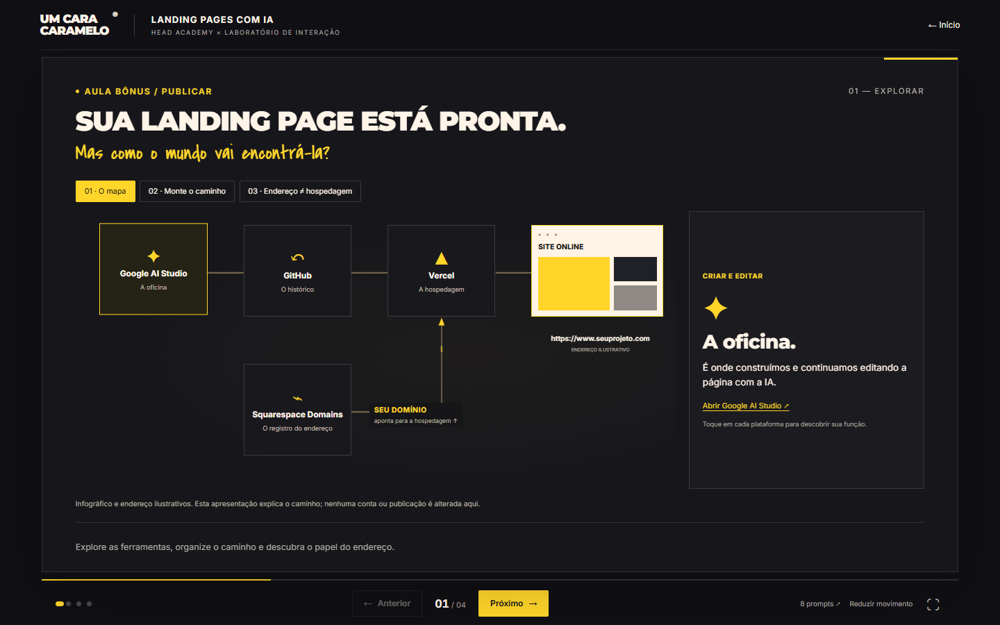
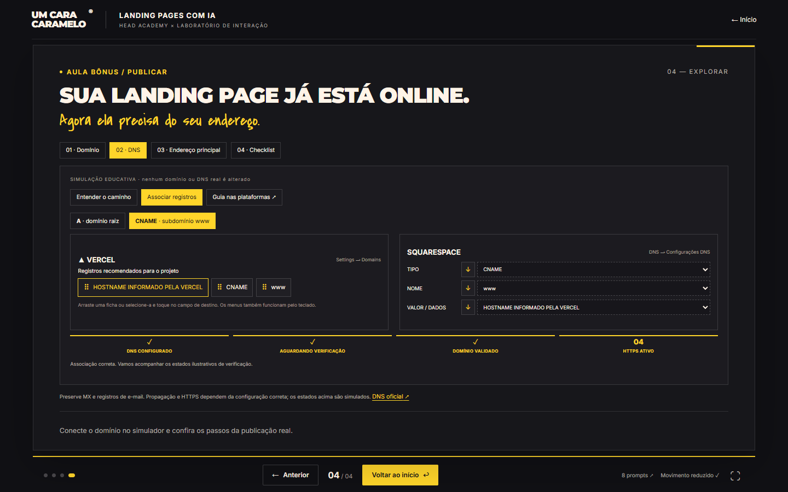

# Landing Pages com IA — validação local

Versão de 22/10/2026: abertura interativa, quatro aulas e a aula bônus PUBLICAR. Vinte slides, com quatro slides por apresentação.

## Comportamento atual

- Abertura original recuperada com vídeo local controlado pelo mouse, logo HEAD, quatro cards de aula e acesso central à aula bônus PUBLICAR.
- Cards de aula compactos: 112–132 px de altura no desktop, 84–96 px no celular e 88–108 px em paisagem baixa. Títulos alinhados à esquerda, personagens e indicador GO proporcionais.
- Cada card abre a apresentação correspondente. Apenas os quatro slides dessa aula ficam disponíveis; o último botão retorna à abertura para escolher outra aula.
- Cabeçalho, palco e navegação cabem na viewport. A tela principal não depende de rolagem vertical. Prompts integrais mantêm leitura interna quando necessário.
- Sem “Meu projeto”, caderno, briefing pessoal, registros de entrega, exportação ou painéis “No seu projeto”. As demonstrações usam estado transitório, sem leitura ou gravação de projeto em localStorage.
- Modo Professor removido: sem botão, notas, janela separada ou sincronização entre janelas. Links antigos com `?professor=1` abrem a apresentação normal.
- O convite “clique em uma seção ←” usa o MagneticButton canônico do MCP Caramelo (magnetic-fill, accent, fill, swap). O clique abre Hero e transfere o foco para a seção do mapa.
- No resultado do Slide 14, os blocos desaparecem antes da entrada do título final. No Slide 16, o encerramento substitui a prévia dentro do quadro, sem camada sobreposta.
- Aula bônus: mapa de publicação, exercício de sequência e analogia domínio/hospedagem; histórico V1–V5 e restauração explícita; simulador de publicação, atualização e diagnósticos; domínio, associação de DNS, endereço principal e checklist expandida com encerramento.
- Todos os simuladores são educativos, com estado transitório. Não conectam contas, publicam sites, compram domínios ou alteram DNS real.

## Fontes

Os oito prompts integrais permanecem idênticos ao acervo anterior, recuperado do bundle original `public/aula-head/assets/index-D2Ot7DKX.js` com o parser do TypeScript. A numeração de uso permanece em `src/aula-head/data.ts`. As notas do professor foram retiradas; os títulos dos slides foram preservados.

O vídeo, poster, logo e artes da abertura continuam em `public/aula-head/`. A cronologia direcional do mouse e o CSS da abertura foram recuperados do bundle e CSS anteriores. O CSS está isolado em `.head-intro`; ajustes de viewport ficam em `intro.css`.

O botão do Slide 02 foi conferido com `get_interaction({id: "magnetic-fill", format: "react"})` do MCP Caramelo e usa o componente de `@caramelo/design-system` 2.0.0, com o CSS canônico já servido em `/caramelo/styles.css`.

Os fluxos da aula bônus foram conferidos em 22/10/2026 nas fontes oficiais: [Google AI Studio e sincronização GitHub](https://ai.google.dev/gemini-api/docs/aistudio-build-mode), [commits no GitHub](https://docs.github.com/en/pull-requests/reference/commits), [Vercel e Git](https://vercel.com/docs/git), [domínios na Vercel](https://vercel.com/docs/domains/set-up-custom-domain), [plano Hobby](https://vercel.com/docs/plans/hobby) e [DNS no Squarespace](https://support.squarespace.com/hc/pt/articles/31119879125645-Registros-DNS-para-hospedagem-na-web). Os guias mostram esquemas ilustrativos, e os registros de DNS usam placeholders para os valores fornecidos pelo projeto.

## Evidências de validação

| Verificação | Resultado |
| --- | --- |
| Build | TypeScript e Vite concluídos. Aviso de tamanho apenas no bundle existente da Comunidade. |
| Abertura | Vídeo carregado, áudio silenciado; olhar para cards esquerdos em 3,1s e direitos em 1,6s, conforme cronologia original. |
| Cards compactos | Conferidos em 1440×900, 1280×720, 390×844 e 844×390, sem rolagem externa. |
| Navegação | Quatro pontos e contador 01/04 a 04/04 em cada aula. Abas para trocar de aula removidas. Voltar ao início funciona no fim de cada aula. |
| Viewports | 16 slides em 1280×720, 390×844 e 844×390: 48 estados sem overflow vertical externo, com rodapé dentro da janela. |
| Movimento reduzido | Painel de ferramentas conferido sem overflow interno nas três dimensões, desconsiderando o deslocamento transitório da animação de entrada. |
| Professor | Modo e código de sincronização removidos. Link antigo com `?professor=1` abre a apresentação normal. |
| CTA canônico | Classes cm-btn, cm-btn--accent, cm-btn--lg e cm-btn--fill. Clique revelou “O que é isso?” e focou o botão Hero do mapa. |
| Dados pessoais | Ausência dos controles de projeto/caderno e de código de persistência localStorage na apresentação. |
| Prompts | Acervo integral preservado e acesso pelo banco na abertura e nas aulas. |
| Correções dos slides 14 e 16 | Renderização React conferida em 402 estados da animação, com e sem movimento reduzido, e oito estados de revisão, incluindo conclusão e desmarcação em Desktop/Celular. Sem coexistência dos blocos e título final, ou da prévia e encerramento. |
| Aula bônus · navegação | Abertura → slide 17, quatro pontos e contador por aula, slide 20 → abertura. Limites e hashes atualizados para 20 slides. |
| Aula bônus · interações | Sequência correta/incorreta, V5, restauração explícita, backend incompatível e variável ausente, publicação Ready, atualização Production/Preview, DNS por clique e teclado, checklist 20/20 em modal e encerramento substitutivo. |
| Aula bônus · layout | 54 estados verificados em 1440×900, 390×844, 844×390 e 375×667. Sem overflow externo ou interno na área da experiência. Dados em `bonus-layout.json`. |
| Abertura com bônus | Cinco acessos sem sobreposição em desktop, 390×844, 375×667, 375×500, 667×375 e 844×390. |
| Preservação | Comparação de dados com o commit anterior: 16 slides e oito prompts idênticos. Slides 14 e 16 também conferidos no navegador: título final com blocos ocultos e conclusão sem prévia por baixo. |

A compilação TypeScript e o build Vite passaram. A inspeção visual dos slides 14 e 16, que estava pendente por limite de acesso ao navegador, foi concluída durante a validação desta entrega.

## Capturas

